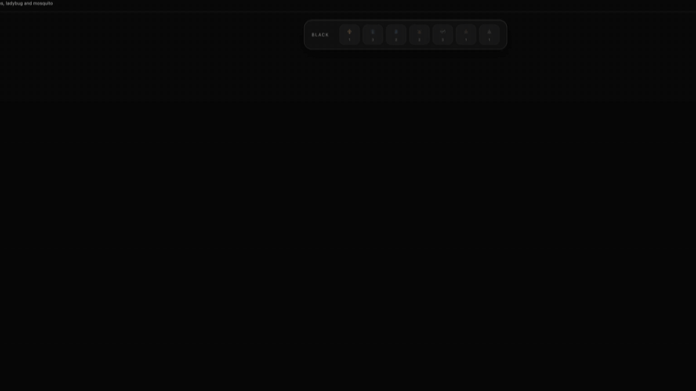

# Termitary

A multiplayer browser version of [Hive](https://en.wikipedia.org/wiki/Hive_(game)), the hex-tile strategy board game. Not affiliated with Gen42 Games.



## Features

- **Online play.** Post a seek, the server pairs you with an opponent, and moves sync in real time over WebSockets.
- **Hot-seat.** Two players on one screen, no account and no server needed.
- **Expansions.** Ladybug, Mosquito and Pillbug, in any combination.
- **Time controls.** Untimed, correspondence (1 or 3 days per move), or real-time with increment (5+3, 15+10).
- **Game archive.** Finished games are saved, and you can replay them move by move.
- **Sign-in** with an email code, Google or GitHub.

## How it is built

A pnpm monorepo in TypeScript. Each package has one job:

| Package | What it does |
| --- | --- |
| `engine` | The game rules. Pure functions, no IO, no framework. |
| `clock` | Time-control logic. Also pure. |
| `protocol` | Zod schemas for every WebSocket message and REST body, shared by server and client. |
| `server` | Fastify + WebSockets, better-auth, Drizzle over SQLite. |
| `web` | React 19 SPA. The board is drawn with Konva on a canvas. |
| `e2e` | Playwright tests that play real games in a browser. |

Some decisions worth a look:

- **The engine is the single source of truth.** `listValidMoves` produces every legal move, and `applyMove` accepts a move only if it is in that list. A new rule changes move generation and nothing else.
- **The board is a sparse map**, keyed by axial hex coordinates. Hive has no fixed board: the pieces are the board. A cell holds a stack, so beetles can climb.
- **The canvas renders outside React.** Konva subscribes to a Zustand store and redraws directly, so a move does not re-render the React tree.
- **Moves are optimistic.** The client applies a move at once, sends it to the server, and rolls back if the server rejects it. The server state always wins.
- **The server is hexagonal.** Use cases depend on ports, and adapters implement them. The plan is to move the backend to AWS step by step, and the ports are where the AWS adapters will plug in.

[`docs/architecture.md`](docs/architecture.md) explains the engine design in detail.

## Testing

- **Engine:** unit tests for every piece and rule, plus a fuzzer. It plays 30 random games of 80 moves and checks invariants after every move.
- **Server:** REST and WebSocket tests against an in-memory database.
- **Browser:** Playwright plays full games between two signed-in players. The canvas has no DOM, so the tests find pieces by hit-testing the Konva stage with the board's own hex maths.

CI runs lint, type check, unit tests, a production build and the browser suite on every pull request.

## Run it locally

Needs Node 24 and pnpm 9.

```bash
pnpm install
pnpm dev        # web on :5173, server on :3001
```

Open http://localhost:5173. To sign in with email, the one-time code is printed in the server console. For a quick game without an account, open `/hotseat`.

Optional settings, such as Google and GitHub sign-in, are in [`docs/configuration.md`](docs/configuration.md).

Other commands:

```bash
pnpm test       # unit tests in every package
pnpm test:e2e   # browser tests (needs ports 5173 and 3001 free)
pnpm lint
pnpm typecheck
```
